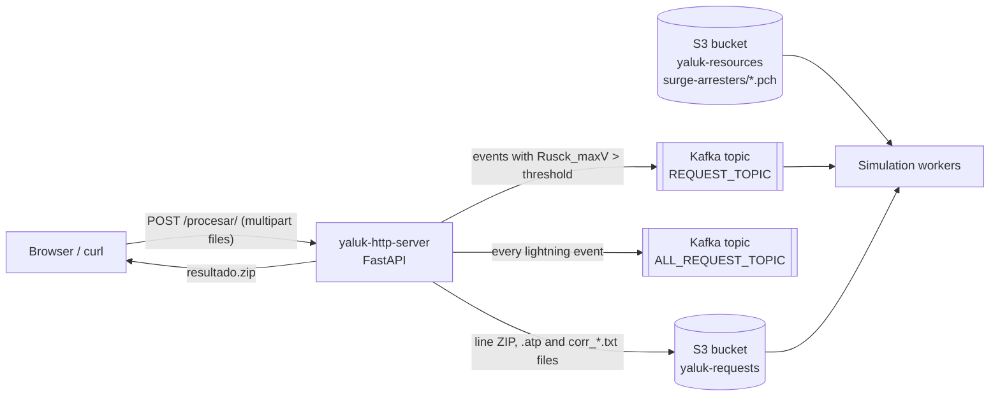
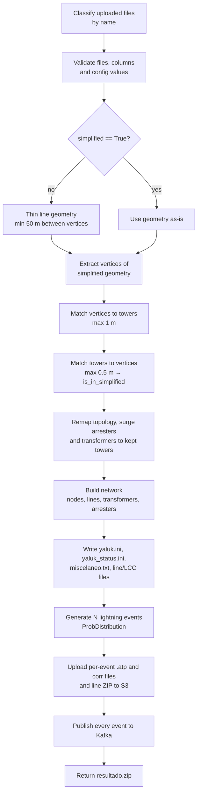

# yaluk-http-server

HTTP front-end for the **YALUK** lightning-overvoltage simulation workflow.

You upload a set of GIS/CSV files describing a power distribution line (towers, line geometry, topology and line settings). The server then:

1. simplifies the line and matches towers to the simplified geometry,
2. builds an electrical network model with `yaluk_network_lib`,
3. generates a statistical set of lightning events,
4. uploads the simulation input files to S3,
5. publishes one Kafka message per lightning event, so downstream workers can run the simulations.

The HTTP response is a small ZIP with a preview image of the simplified line and a node-mapping CSV.

---

## Table of contents

- [Architecture](#architecture)
- [Processing pipeline](#processing-pipeline)
- [Requirements](#requirements)
- [Configuration (.env)](#configuration-env)
- [Running the server](#running-the-server)
- [API](#api)
- [Input files](#input-files)
- [Example: 5-tower line](#example-5-tower-line)
- [Outputs](#outputs)
- [Built-in catalogs](#built-in-catalogs)
- [Errors](#errors)
- [Project structure](#project-structure)
- [License](#license)

---

## Architecture



The server holds no state. It does not store anything on local disk; every artifact goes to S3, to Kafka or into the HTTP response.

## Processing pipeline



In detail:

1. **File classification.** Each uploaded file gets a *kind* based on its name (see [File naming rules](#file-naming-rules)). Only one file per kind is allowed.
2. **Validation.** The `nodes`, `line`, `vertices` and `config` files are required. The server also checks for required columns and required config keys. `name` may contain only letters, digits, space, `.`, `_` and `-`.
3. **Line simplification.** When `simplified` is not `True`, consecutive vertices closer than **50 m** are removed (first and last vertices are always kept). This works for `LineString`, `Polygon` and `Multi*` geometries.
4. **Tower matching.**
   - Each vertex of the simplified line is matched to its nearest tower, and the match is discarded if the tower is farther than **1 m**.
   - Each tower is then matched to its nearest simplified vertex. Towers within **0.5 m** are kept as network nodes (`is_in_simplified = True`).
   - Every other tower is *remapped* to the name of its closest kept tower.
5. **Topology remap.** Segments in the vertices file are renamed with that mapping. Self-loops (`A → A`) are dropped, and so are duplicate segments (in either direction). Surge arresters and transformers are moved to the remapped node as well.
6. **Network model.**
   - Nodes are added with absolute coordinates, grounding resistance (`RPAT`) and structure `configuration`.
   - Each line segment uses the configuration of its **`from_node`**.
   - All lines are marked as FDTD.
   - Transformers and surge arresters are then attached.
7. **Project files.** `yaluk.ini`, `yaluk_status.ini`, `CaseFiles/miscelaneo.txt`, the line files and the LCC library are generated in memory.
8. **Lightning statistics.** `events` lightning strokes are generated from a probability distribution, and the per-event table is stored as `<name>_all.csv`.
9. **S3 upload.** For each event, the server uploads the ATP file and the stroke waveform file. It then uploads the full line ZIP.
10. **Kafka publish.** Each event is sent to `ALL_REQUEST_TOPIC`. Events whose `Rusck_maxV` is greater than `rusck_maxv_threshold` also go to `REQUEST_TOPIC`. Messages use the Kafka Connect JSON format with an embedded schema.
11. **Response.** `resultado.zip` is returned with the preview image and the node-mapping CSV.

> The request is synchronous and CPU-heavy. With many events it can take a while, so set generous client and proxy timeouts.

## Requirements

- Python **3.14+** (the code uses `uuid.uuid7`)
- `yaluk_network_lib`. It is **not** part of this repository and is not listed in `requirements.txt`, so install it separately into the same environment or image.
- A reachable Kafka cluster
- An S3 or S3-compatible bucket named **`yaluk-requests`**
- Python dependencies from [requirements.txt](requirements.txt)

## Configuration (.env)

Configuration comes only from environment variables. Copy the template and edit it:

```bash
cp .env.example .env
```

| Variable | Required | Description |
|---|---|---|
| `KAFKA_BOOTSTRAP_SERVERS` | yes | Kafka bootstrap servers, e.g. `kafka:9092` |
| `ALL_REQUEST_TOPIC` | yes | Topic that receives **every** lightning event |
| `REQUEST_TOPIC` | yes | Topic that receives only events with `Rusck_maxV > rusck_maxv_threshold` |
| `S3_ENDPOINT_URL` | no | S3-compatible endpoint (MinIO, Ceph, …). Leave empty for AWS S3 |
| `AWS_ACCESS_KEY_ID` | no* | S3 access key |
| `AWS_SECRET_ACCESS_KEY` | no* | S3 secret key |
| `AWS_DEFAULT_REGION` | no | Region used by boto3 |

\* Optional only when credentials come from another boto3 source (IAM role, `~/.aws/credentials`, …).

If a required Kafka variable is missing, the server fails at startup with `RuntimeError: Missing required environment variable ...`.

Example [.env.example](.env.example):

```dotenv
# Kafka
KAFKA_BOOTSTRAP_SERVERS=localhost:9092
ALL_REQUEST_TOPIC=yaluk-all-requests
REQUEST_TOPIC=yaluk-requests

# S3 / S3-compatible storage (MinIO, Ceph, ...). Leave S3_ENDPOINT_URL empty for AWS S3.
S3_ENDPOINT_URL=http://localhost:9000
AWS_ACCESS_KEY_ID=minioadmin
AWS_SECRET_ACCESS_KEY=minioadmin
AWS_DEFAULT_REGION=us-east-1
```

`.env` is listed in `.gitignore`. Never commit real credentials.

## Running the server

### Local

```bash
python3.14 -m venv .venv
source .venv/bin/activate
pip install -r requirements.txt
pip install <path-or-url-to-yaluk_network_lib>

set -a; source .env; set +a
cd src
uvicorn main:app --host 0.0.0.0 --port 8000 --reload
```

Templates are loaded relative to `main.py`, so the server can be started from any directory as long as `main` is importable.

The server never reads surge-arrester `.pch` files, so they do not need to be on the server. See [Surge arrester models](#surge-arrester-models).

### Docker

```bash
docker build -t yaluk-http-server .
docker run --rm -p 8000:8000 --env-file .env yaluk-http-server
```

The image:

- is based on `python:3.14-bookworm` and runs as the unprivileged `yaluk` user,
- copies `src/main.py` and `src/templates/` into `/opt/yaluk-http-server`,
- starts `uvicorn main:app --host 0.0.0.0 --port 8000`.

> `yaluk_network_lib` must be available inside the image, either by extending the Dockerfile or by building from a base image that already contains it.

### Dev container

[.devcontainer/devcontainer.json](.devcontainer/devcontainer.json) builds the same Dockerfile, so you can open the repository in VS Code with *Dev Containers: Reopen in Container*.

## API

### `GET /`

A simple HTML page where you pick files and send them to `/procesar/`. It downloads `resultado.zip` automatically.

### `POST /procesar/`

`multipart/form-data` with one or more files under the field name **`files`**.

```bash
curl -X POST http://localhost:8000/procesar/ \
  -F "files=@examples/example_towers.csv" \
  -F "files=@examples/example_line.geojson" \
  -F "files=@examples/example_vertices.csv" \
  -F "files=@examples/example_config.csv" \
  -o resultado.zip
```

| Status | Meaning |
|---|---|
| `200` | `application/zip` attachment named `resultado.zip` |
| `400` | Invalid input; the reason is in the JSON `detail` field (see [Errors](#errors)) |
| `422` | No `files` field in the request |
| `500` | Unexpected error (S3, Kafka, library) |

Interactive OpenAPI docs are served at `/docs`.

## Input files

### File naming rules

The server decides what each file is **by its name**:

1. The name without its extension is split into tokens at every non-alphanumeric character (`_`, `-`, `.`, space, …).
2. The kinds below are checked **in order**. A file gets the first kind that has a token *starting with* the keyword. Matching is **case-sensitive**.
3. A file that matches no keyword is the **nodes** file.

| Order | Keyword | Kind | Used |
|---|---|---|---|
| 1 | `vertices` | Topology (segments) | **required** |
| 2 | `info` | Line info | accepted, ignored |
| 3 | `config` | Line settings | **required** |
| 4 | `transformers` | Transformers | accepted, ignored (transformers come from the nodes file) |
| 5 | `dps` | Surge arresters | accepted, ignored (arresters come from the nodes file) |
| 6 | `line` | Line geometry | **required** |
| — | *(none)* | Nodes / towers | **required** |

Examples:

| File name | Kind |
|---|---|
| `example_towers.csv` | nodes |
| `pipeline_nodes.csv` | nodes (`pipeline` does not *start* with `line`) |
| `line_info.csv` | info (`info` is checked before `line`) |
| `line_vertices.csv` | vertices |
| `feeder_lines.geojson` | line |
| `Linea_norte.csv` | nodes (`Linea` ≠ `line`: case-sensitive) |
| `linea_norte.csv` | **line**. Avoid names like this for other kinds of file. |

Uploading two files of the same kind returns `400`.

### Nodes / towers file

Either a CSV (extension `.csv`) or any vector format GDAL can read (GeoJSON, GeoPackage, Shapefile ZIP, …) with point geometries.

- **CSV:** the coordinates come from the `X` and `Y` columns and are **always taken as EPSG:3118** (MAGNA-SIRGAS / Colombia Bogotá).
- **Vector file:** the file's own CRS is used.

| Column | Type | Required | Description |
|---|---|---|---|
| `X`, `Y` | float | CSV only | Projected coordinates in meters (EPSG:3118) |
| `fid` | number | yes | Order of the towers along the line |
| `node_label` | string | yes | Unique tower name, referenced by the vertices file |
| `RPAT` | float | yes | Grounding (footing) resistance in Ω |
| `configuration` | string | yes | Structure type, one of the [configurations](#structure-configurations) |
| `dps_label` | string | yes (may be empty) | Surge arrester label |
| `dps_phases` | int | yes (may be empty) | [Phase mask](#phase-masks) of the phases the arrester connects to, e.g. `111` |
| `dps_file` | string | yes (may be empty) | Arrester model file **name only**, e.g. `15kV-3ph.pch`, with no directory. It must exist in S3 (see [Surge arrester models](#surge-arrester-models)). Allowed characters: letters, digits, `_`, `.`, `-`. **Leave empty when the tower has no arrester** |
| `trf_label` | string | yes (may be empty) | Transformer label |
| `trf_phases` | int | yes (may be empty) | [Phase mask](#phase-masks) of the transformer, e.g. `111` |
| `trf_type` | string | yes (may be empty) | [Transformer type](#transformer-types). **Leave empty when the tower has no transformer** |

All columns must exist. The `dps_*` and `trf_*` columns can be empty on rows without equipment.

#### Phase masks

`dps_phases` and `trf_phases` are 3-digit masks made of `0` and `1` digits, where each `1` means that phase is connected. Any other value returns `400`.

| Mask | Surge arrester (`dps_phases`) | Transformer (`trf_phases`) |
|---|---|---|
| `111` | A, B, C | A, B, C |
| `110` | A, B | B, C |
| `101` | A, C | A, C |
| `11` | B, C | A, B |
| `100` | A | C |
| `10` | B | B |
| `1` | C | A |

> `yaluk_network_lib` reads the digits in **opposite order** for surge arresters (`100` = A) and transformers (`1` = A). The table shows how each one is actually interpreted. `111` is the same for both.

### Line geometry file

A vector file (GeoJSON, GeoPackage, …) with `LineString`/`MultiLineString` features. All features are merged into one geometry and Z values are dropped.

- The coordinates **must be in the same CRS as the towers** and must pass **through the tower positions**: vertices within 1 m of a tower, towers within 0.5 m of a vertex.
- If `simplified = False`, vertices closer than 50 m to the previous kept vertex are removed before matching.

### Vertices (topology) file

A CSV listing the electrical segments between towers.

| Column | Required | Description |
|---|---|---|
| `from_node` | yes | `node_label` of the start tower. The segment uses **this tower's configuration** |
| `to_node` | yes | `node_label` of the end tower |

Extra columns are ignored. Segments are remapped onto the kept towers, and self-loops and duplicates (in either direction) are removed.

### Config file

A two-column CSV. The first column is the key and the second must be called `value`.

| Key | Required | Default | Description |
|---|---|---|---|
| `name` | yes | — | Line name, used in S3 keys, file names and Kafka messages. Allowed characters: letters, digits, space, `.`, `_`, `-` |
| `simplified` | yes | — | `True` if the geometry is already simplified. Anything else runs the 50 m thinning |
| `events` | yes | — | Number of lightning events to generate (integer) |
| `rusck_maxv_threshold` | no | `50` | An event is sent to `REQUEST_TOPIC` when its `Rusck_maxV` is **greater** than this value |

## Example: 5-tower line

Ready-to-use files are in [examples/](examples/). The example is a 15 kV line with four spans on the main run and one branch:

```
                         T5  (S-121, SA5, TR5)
                         │
                         │ 150 m
                         │
T1 ───── T2 ───── T3 ────┴──── T4
(SA1)    150 m    158 m (TR3)  150 m   (SA4)
```

- **Main run:** T1 → T2 → T3 → T4
- **Branch:** T3 → T5
- **Surge arresters:** T1 and T4 (both line ends) and T5 (branch end)
- **Transformers:** `Tr1` at T3, `Tr2` at T5
- **Structures:** all segments use `R-131`, because a segment takes its `from_node` configuration. T5 is `S-121`, but no segment starts at T5.

### `examples/example_towers.csv` (nodes)

```csv
X,Y,fid,node_label,RPAT,configuration,dps_label,dps_phases,dps_file,trf_label,trf_phases,trf_type
1000000,1000000,1,T1,10,R-131,SA1,111,15kV-3ph.pch,,,
1000150,1000000,2,T2,10,R-131,,,,,,
1000300,1000050,3,T3,15,R-131,,,,TR3,111,Tr1
1000450,1000050,4,T4,10,R-131,SA4,111,15kV-3ph.pch,,,
1000300,1000200,5,T5,20,S-121,SA5,111,15kV-3ph.pch,TR5,111,Tr2
```

> All equipment is three-phase (`111`). `dps_file` holds only the file name. The worker downloads it from S3 (see [Surge arrester models](#surge-arrester-models)).

### `examples/example_line.geojson` (line)

```json
{
  "type": "FeatureCollection",
  "name": "example_line",
  "crs": { "type": "name", "properties": { "name": "urn:ogc:def:crs:EPSG::3118" } },
  "features": [
    {
      "type": "Feature",
      "properties": { "name": "main" },
      "geometry": {
        "type": "LineString",
        "coordinates": [[1000000, 1000000], [1000150, 1000000], [1000300, 1000050], [1000450, 1000050]]
      }
    },
    {
      "type": "Feature",
      "properties": { "name": "branch" },
      "geometry": {
        "type": "LineString",
        "coordinates": [[1000300, 1000050], [1000300, 1000200]]
      }
    }
  ]
}
```

### `examples/example_vertices.csv` (topology)

```csv
from_node,to_node
T1,T2
T2,T3
T3,T4
T3,T5
```

### `examples/example_config.csv` (settings)

```csv
key,value
name,Example_Line
simplified,True
events,100
rusck_maxv_threshold,50
```

### Resulting network

The server builds this model from the files above:

| id | label | x | y | RPAT | configuration |
|---|---|---|---|---|---|
| 1 | T1 | 1000000 | 1000000 | 10 | R-131 |
| 2 | T2 | 1000150 | 1000000 | 10 | R-131 |
| 3 | T3 | 1000300 | 1000050 | 15 | R-131 |
| 4 | T4 | 1000450 | 1000050 | 10 | R-131 |
| 5 | T5 | 1000300 | 1000200 | 20 | S-121 |

| line id | from_node | to_node |
|---|---|---|
| 1 | T1 | T2 |
| 2 | T2 | T3 |
| 3 | T3 | T4 |
| 4 | T3 | T5 |

Transformers: `TR3@T3 (Tr1)` and `TR5@T5 (Tr2)`. Surge arresters: `SA1@T1`, `SA4@T4` and `SA5@T5` (`15kV-3ph.pch`).

### Adding intermediate points

A tower that is **not** on the simplified geometry gets remapped automatically. For example, add a tower `T2b` at `(1000160, 1000001)`, list it in the vertices file as `T2,T2b` and `T2b,T3`, and leave the geometry unchanged. `T2b` is then merged into its closest kept tower (`T2`), the self-loop `T2 → T2` is dropped, and `T2b → T3` becomes `T2 → T3`, which already exists and is deduplicated.

## Outputs

### HTTP response: `resultado.zip`

| File | Description |
|---|---|
| `<name>_vertices.png` | Plot of the towers and original line (red), the simplified line (blue) and the simplified vertices (green) |
| `<name>_info.csv` | Node mapping: whether each tower is kept, which kept tower it maps to, and the resulting network node data |

### S3 (bucket `yaluk-requests`)

| Key | Content |
|---|---|
| `<name>.zip` | Line files, LCC library, `yaluk.ini`, `yaluk_status.ini`, `CaseFiles/miscelaneo.txt`, `<name>_all.csv` |
| `<name>_<N>.atp` | ATP model for lightning event `N` (1-based) |
| `<name>/corr_<NNNNN>.txt` | Lightning current waveform for event `N` (zero-padded to 5 digits) |

For the example line with `events = 100`, that is `Example_Line.zip`, `Example_Line_1.atp` … `Example_Line_100.atp` and `Example_Line/corr_00001.txt` … `Example_Line/corr_00100.txt`.

### Kafka

Each message is a Kafka Connect JSON envelope (`{"schema": ..., "payload": ...}`) with struct name `nowcast-linet-stroke.Value`.

| Field | Type | Source |
|---|---|---|
| `id` | string | UUIDv7 generated per message |
| `Case` | int32 | Lightning event number |
| `Ih1`, `Ih2` | float | Current peak parameters (Heidler) |
| `tao11`, `tao21`, `tao12`, `tao22` | float | Heidler time constants |
| `n1`, `n2` | int8 | Heidler steepness factors |
| `X0`, `Y0` | float | Strike location |
| `delete_tmp` | boolean | Always `true` |
| `case` | string | Line `name` |
| `min_dist` | float | Minimum distance from the strike to the line |
| `direct_strike` | int8 | `1` if the stroke hits the line directly |
| `Line_id` | int32 | Closest line segment |
| `Rusck_maxV` | float | Maximum induced voltage estimated with Rusck's formula |
| `surge_arresters` | string | JSON-encoded list of the distinct `.pch` file names in the network. The worker downloads each one from S3 |

- Numeric values missing from the lightning table are sent as `null`, and missing text values as `"Not defined"`.
- An event with a `null` `Rusck_maxV` is never sent to `REQUEST_TOPIC`.

Example payload (values are illustrative):

```json
{
  "schema": { "type": "struct", "name": "nowcast-linet-stroke.Value", "fields": ["..."] },
  "payload": {
    "Case": 0,
    "Ih1": 28.5, "Ih2": 3.1,
    "tao11": 1.8e-6, "tao21": 95e-6, "tao12": 0.25e-6, "tao22": 2.5e-6,
    "n1": 2, "n2": 2,
    "X0": 1000210.4, "Y0": 1000380.9,
    "min_dist": 180.3,
    "direct_strike": 0,
    "Line_id": 4,
    "Rusck_maxV": 73.2,
    "id": "01927f3a-8c1e-7b4a-9d2f-3e5a6b7c8d9e",
    "delete_tmp": true,
    "case": "Example_Line",
    "surge_arresters": "[\"15kV-3ph.pch\"]"
  }
}
```

Here `Rusck_maxV = 73.2 > 50`, so this event goes to **both** topics.

## Built-in catalogs

These values are defined in [src/main.py](src/main.py). Edit the code to change them.

### Conductors

| Name | Radius (m) | Resistance (Ω/km) |
|---|---|---|
| Conductor 4/0 AWG (CENTELSA) | 0.0143 | 0.2667 |
| Guard cable ACSR 110 KCMIL | 0.0061 | 0.5163 |

### Structure configurations

Positions are `(height m, horizontal offset m)`. **P** is a phase conductor (4/0) and **G** is a guard cable.

| Key | Name | Description | Conductors |
|---|---|---|---|
| `R-580` | R-580 | Linea un solo conductor | P(12, 2) P(12, 0) P(12, −2) |
| `R-560` | Mono LAR2 | Linea un solo conductor | P(12, 2) P(12, 0) P(12, −2) |
| `S-121` | S-121 | Poste disposicion vertical | P(11.9, 0) P(9.9, 0) P(7.9, 0) |
| `R-131` | R-131 | Poste disposicion vertical | P(12, 2) P(12, 0) P(12, −2) |
| `S-131` | S-131 | Poste disposicion vertical | P(12, 2) P(12, 0) P(12, −2) |
| `S-125` | S-125 | Poste disposicion vertical | P(9.85, −0.9) P(11.25, 0.65) P(9.85, 0.9) G(12.9, 0) |
| `R-114` | R-114 | Poste disposicion vertical | P(11.5, 1.8) P(11.5, 0) P(11.5, −1.8) |
| `SH-226` | SH-226 | Poste disposicion vertical | P(12, 2) P(12, 0) P(12, −2) |
| `RH-231` | RH-231 | Poste disposicion vertical | P(12, 2) P(12, 0) P(12, −2) |
| `R-133` | R-133 | Poste disposicion vertical | P(9.98, 2.38) P(9.98, 0) P(9.98, −2.38) |
| `TORRECILLA` | TORRECILLA | Poste disposicion vertical | P(11.9, 0) P(9.9, 0) P(7.9, 0) |
| `R-550` | RH-550 | Poste disposicion vertical | P(12, 2) P(12, 0) P(12, −2) |
| `PORTICO` | PORTICO | Poste disposicion vertical | P(12, 2) P(12, 0) P(12, −2) |
| `S-126` | S-126 | Poste disposicion vertical | P(11.9, 2.53) P(11.9, 0) P(11.9, −2.53) |
| `R-126` | R-126 | Poste disposicion vertical | P(11.9, 2.38) P(11.9, 0) P(11.9, −2.38) |
| `C345` | — | Poste en H 34,5 kV | P(12, −2) P(12, 0) P(12, 2) G(14, −1) G(14, 1) |
| `C144` | — | Poste vertical 14,4 kV | P(10, −1) P(10, 1) P(10, 0) G(12, 0) |
| `C230` | — | Poste vertical 230 kV | P(10, −1) P(10, 1) P(10, 0) G(12, 0) |

### Transformer types

| `trf_type` | CHV (F) | CLV (F) | CHL (F) | Ground (Ω) |
|---|---|---|---|---|
| `Tr1` | 340e-12 | 215e-12 | 744e-12 | 10.0 |
| `Tr2` | 440e-12 | 115e-12 | 644e-12 | 20.0 |

### Surge arrester models

`dps_file` only holds a **file name**, and the `.pch` files are not bundled with this server:

1. `yaluk_network_lib` writes the name into the ATP model as `$INCLUDE, <dps_file>` and never opens the file.
2. The name is sent to the worker in the Kafka field `surge_arresters`.
3. The worker (`yaluk-worker`) downloads each file from `s3://<S3_RESOURCES_BUCKET>/<S3_SURGE_ARRESTERS_PREFIX>/<dps_file>` (default `s3://yaluk-resources/surge-arresters/<dps_file>`) into the simulation directory, next to the `.atp` file, so the `$INCLUDE` resolves.

As a result:

- `dps_file` must be a bare file name. A path such as `surge_arresters/15kV-3ph.pch` is rejected, because the worker would refuse it.
- Every file referenced in `dps_file` must already be uploaded to that bucket and prefix. Otherwise the worker fails when it downloads the file.

[surge_arresters/](surge_arresters/) in this repository holds the reference models, which can be uploaded to the resources bucket:

```bash
aws s3 cp surge_arresters/ s3://yaluk-resources/surge-arresters/ --recursive --exclude "*" --include "*.pch"
# add --endpoint-url "$S3_ENDPOINT_URL" for MinIO / S3-compatible storage
```

| File | Description |
|---|---|
| `15kV-3ph.pch` | 15 kV, three-phase |
| `34.5kV.pch` | 34.5 kV |
| `saieee_15kv_1ph.pch` | 15 kV IEEE model, single-phase |
| `saieee_15kv_2ph.pch` | 15 kV IEEE model, two-phase |
| `saieee_15kv_3ph.pch` | 15 kV IEEE model, three-phase |

### Simulation settings

| Group | Parameter | Value |
|---|---|---|
| Simulation | `Dx` | 15.0 m |
| | `Typewaveform` | 0 |
| | `MaxDistCamp` | 5000.0 m |
| | `Print_field`, `Print_field_info`, `Read_field`, `Status_profile` | False |
| Channel | `Velocity` | 2e8 m/s |
| | `Atenuation_const` | 2e3 m |
| | `Heigth` | 8000 m |
| Soil | `Conductivity` | 1e-3 S/m |
| | `Permitivity` | 10.0 |
| | `Perfectsoil` | False |
| ATP | `printfreq`, `plotfreq`, `pl4out`, `NetwrkOut`, `SSPhasor`, `MaxMinOut`, `MemSave`, `ExtrPinOut` | 999999, 1, 1, 1, 1, 1, 0, 0 |

### Geometry tolerances

| Constant | Value | Purpose |
|---|---|---|
| `THIN_TOLERANCE` | 50 m | Minimum spacing between vertices when thinning |
| `MAX_DIST` | 1 m | Maximum distance from a simplified vertex to a tower |
| `TOL` | 0.5 m | Maximum distance from a tower to a simplified vertex for the tower to be kept |

## Errors

Validation errors return `400` with a JSON body:

```json
{ "detail": "Missing required files: vertices, config" }
```

| `detail` message | Cause |
|---|---|
| `Missing required files: ...` | A nodes, line, vertices or config file was not uploaded, or its name was classified as another kind |
| `More than one '<kind>' file was uploaded` | Two files have the same kind |
| `<file> is missing columns: ...` | A required column is missing |
| `Missing '<key>' in config file` | `name`, `simplified` or `events` is missing or empty |
| `Invalid line name '<name>'` | `name` has characters that are not allowed, or contains `..` |
| `Invalid numeric value in config file: ...` | `events` or `rusck_maxv_threshold` is not a number |
| `No nodes defined in the network.` | No tower lies on the simplified geometry (check CRS and coordinates) |
| `No lines defined in the network.` | Every segment collapsed into a self-loop or was a duplicate |
| `Line <id>: node '<label>' not found in network.` | A segment references a tower that is not a network node |
| `Unknown configuration '<cfg>' at node '<label>'.` | `configuration` is not in the [catalog](#structure-configurations) |
| `Unknown transformer type '<type>' for transformer '<label>'.` | `trf_type` is not `Tr1` or `Tr2` |
| `Invalid dps_file '<file>' for surge arrester '<label>': ...` | `dps_file` contains a directory or characters that are not allowed |
| `Invalid dps_phases of surge arrester '<label>': ...` / `Invalid trf_phases of transformer '<label>': ...` | The value is not a valid [phase mask](#phase-masks) |
| `Surge arrester '<label>': node '<label>' not found in network.` | An arrester's (remapped) tower is not a network node |

Kafka delivery failures are logged (`Kafka delivery to <topic> failed: ...`) and do not fail the request. Check the server logs after a run.

## Project structure

```
.
├── Dockerfile               # Production image (uvicorn on :8000)
├── .devcontainer/           # VS Code dev container using the Dockerfile
├── .env.example             # Environment variable template
├── requirements.txt         # Python dependencies (yaluk_network_lib not included)
├── src/
│   ├── main.py              # FastAPI app and processing pipeline
│   └── templates/
│       └── index.html       # Upload page served at /
├── surge_arresters/         # Reference surge arrester models (.pch), to be uploaded to the resources bucket
└── examples/                # 5-tower example input files
```

## License

GNU General Public License v3.0. See [LICENSE](LICENSE).
